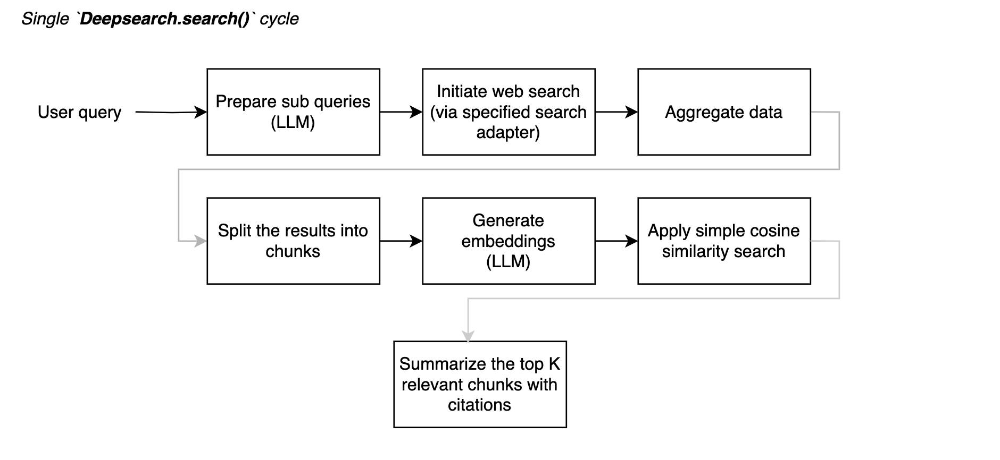

# deepsearch-rb

Una gema de Ruby para realizar búsquedas web automatizadas impulsadas por LLM.
Las únicas dependencias en tiempo de ejecución son [ruby_llm](https://github.com/crmne/ruby_llm?tab=readme-ov-file) y [async](https://github.com/socketry/async).



<details>
<summary>🎥 Una demostración simple dentro de una aplicación Sinatra que muestra el flujo básico de 1 ciclo. (`examples/simple_webapp`) ▶️</summary>


</details>

---

**NOTA**: También puedes implementar tus propias cadenas de la manera que te funcione mejor, buscando con BFS/DFS sobre cualquier tema.
Consulta la implementación preliminar del flujo de múltiples cadenas en `examples/multi-step-chain/script.rb`

## Instalación

[](https://github.com/alexshagov/deepsearch-rb/actions/workflows/ruby.yml)

### Instalación rápida mediante nix flakes

Si estás utilizando nix flakes, simplemente ejecuta `nix develop` y entrarás en un entorno de desarrollo completamente preparado.

De lo contrario, asegúrate de tener instalada la `required_ruby_version` = ">= 3.2.0".

```ruby
# Gemfile
gem 'deepsearch-rb'
# ..

bundle install
```

O instala desde una carpeta local:
```bash
gem 'deepsearch-rb', path: '<path_to_gem>'
```

## Ejemplos

Consulta la carpeta `examples/` para una prueba simple, así como una mini aplicación Sinatra que transmite eventos de la gema a través de la interfaz websocket. 

## Opciones de Configuración

### Configuración mínima

- La configuración del LLM se basa completamente en la gema [ruby_llm](https://github.com/crmne/ruby_llm?tab=readme-ov-file).
- Hay dos adaptadores de búsqueda integrados que puedes usar directamente:
  - [tavily](http://tavily.com/)
  - [serper](http://serper.dev/playground)

```ruby
Deepsearch.configure do |config|
  config.search_adapter = :tavily  # or :serper, :mock
  config.tavily_api_key = "your_tavily_api_key"
  config.serper_api_key = "your_serper_api_key"
  
  # LLM configuration (all config options are coming from `ruby_llm` gem),
  # you can experiment with any model you like
  config.ruby_llm.gemini_api_key = ENV['GEMINI_API_KEY']
  config.ruby_llm.default_model = 'gemini-2.0-flash-lite'
  config.ruby_llm.default_embedding_model = 'text-embedding-004'
  # ..
end
```

### Configuración avanzada

#### Especificar tu propio adaptador de búsqueda

```ruby
class MyCustomAdapter
  def initializeт;end

  def search(query, options = {})
    # Implement your search logic here
    {
      "results" => [
        { "url" => "https://example.com/result1", "content" => "Content 1 from custom search" }
      ]
    }
  end
end

Deepsearch.configure { |config| config.custom_search_adapter_class = MyCustomAdapter }
```

#### Especificar tus propios prompts

Consulta la interfaz `Deepsearch::PromptsConfig` para conocer los métodos y argumentos esperados.

```ruby
class MyPromptsConfig < Deepsearch::PromptsConfig
  def subquery_prompt(query:)
    <<~PROMPT
      You are a search expert. Given this query: "#{query}",
      generate 3 alternative search queries that would help find more information.
      Return them as a simple list, one per line.
    PROMPT
  end

  # Override other prompt methods as needed
end

Deepsearch.configure { |config| config.prompts_config = MyPromptsConfig.new }
```

#### Especificar listener de eventos

```ruby
class MyListener
  def on_deepsearch_event(event, step:, result:)
    puts "Event: #{event}, Step: #{step}, Success: #{result.success?}"
  end
end

Deepsearch.configure { |c| c.listener = MyListener.new }
```

#### Especificar el máximo total de resultados de búsqueda

```ruby
result = Deepsearch.search("Ruby 3 unknown features", max_total_search_results: 25)
```

# Licencia

La gema está disponible como código abierto bajo los términos de la [Licencia MIT](https://opensource.org/licenses/MIT).
